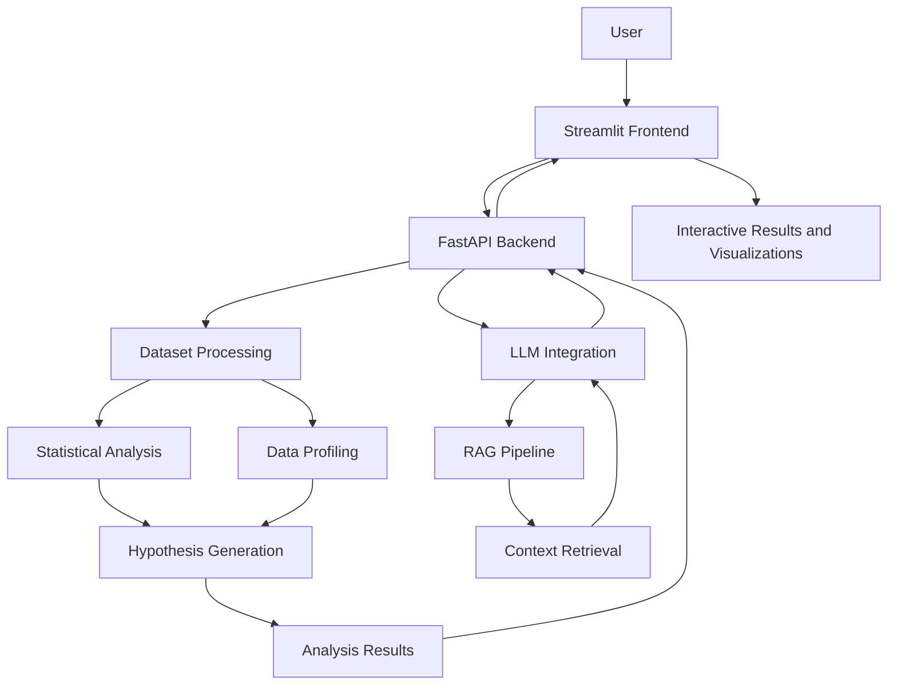

# Intellianalyzer 🧠📊

### AI-Powered Dataset Analysis & Statistical Insights

Intellianalyzer is an AI-powered data analysis platform that helps users explore datasets, discover meaningful patterns, generate statistical hypotheses, perform statistical tests, and interact with their data using natural language.

The platform combines **Large Language Models (LLMs), statistical analysis, data visualization, and Retrieval-Augmented Generation (RAG)** to make data exploration more accessible and efficient.

Instead of manually exploring every column and writing statistical code, users can upload a dataset and use AI-assisted analysis to understand its characteristics, investigate relationships, and discover potential insights.

---

## ✨ Features

### 📂 Dataset Upload & Exploration
- Upload datasets in supported file formats, such as CSV.
- Automatically inspect dataset dimensions, columns, and data types.
- Generate descriptive statistics and dataset summaries.
- Identify missing values and potential data quality issues.

### 📈 Interactive Data Visualization
- Explore numerical distributions using interactive charts.
- Visualize data using histograms, box plots, and other suitable plots.
- Investigate relationships between numerical features.
- Understand the distribution and characteristics of individual columns.

### 🧠 AI-Powered Hypothesis Generation
- Discover potentially interesting relationships between dataset features.
- Generate hypotheses based on dataset characteristics.
- Recommend relevant questions for further investigation.
- Identify patterns that may deserve additional statistical analysis.

### 🔬 Statistical Testing
- Select suitable statistical tests for supported analysis scenarios.
- Execute statistical tests on dataset variables.
- Calculate p-values and interpret statistical results.
- Present findings in a structured, user-friendly format.

Examples of supported test types may include:
- Chi-square test
- Mann–Whitney U test
- Kruskal–Wallis test
- Spearman rank correlation

The specific tests available depend on the implemented analysis pipeline and the characteristics of the dataset.

### 💬 Natural-Language Data Chat
- Ask questions about the uploaded dataset using natural language.
- Retrieve relevant dataset summaries and analysis findings.
- Explore generated hypotheses and statistical results conversationally.
- Use an LLM with Retrieval-Augmented Generation (RAG) to provide context-aware responses.

For exact numerical questions, the backend should execute appropriate computations against the underlying dataset rather than relying solely on retrieved summaries.

### 📋 Analysis Reports
- Review dataset summaries and analysis findings in one place.
- Explore generated hypotheses and their statistical results.
- Inspect data quality observations.
- Identify recommended questions and possible directions for further analysis.

---

## 🏗️ System Architecture

Intellianalyzer separates the user interface from the AI-powered analysis backend.



### Workflow

1. The user uploads a dataset through the Streamlit interface.
2. The FastAPI backend receives and processes the dataset.
3. The analysis pipeline examines dataset structure, data quality, and statistical characteristics.
4. The system generates potential hypotheses and executes applicable statistical tests.
5. The LLM helps interpret results and answer natural-language questions.
6. The RAG pipeline retrieves relevant contextual information from available analysis knowledge.
7. The frontend presents the findings, charts, and conversational responses.

---

## 🛠️ Technology Stack

| Component | Technologies |
|---|---|
| Programming Language | Python |
| Frontend | Streamlit |
| Backend API | FastAPI |
| Data Processing | Pandas, NumPy |
| Statistical Analysis | SciPy and applicable statistical libraries |
| Data Visualization | Plotly |
| Language Model | Qwen3-4B-Instruct |
| LLM Integration | Hugging Face Transformers |
| Retrieval-Augmented Generation | LangChain, FAISS |
| Development Environment | Google Colab and local development tools |
| API Tunneling | ngrok during development |

*The technology list should be adjusted if your final implementation uses different libraries or model versions.*

---

## 🚀 Getting Started

### Prerequisites

Before running the project, make sure you have:

- Python 3.10 or later, compatible with your installed dependencies.
- Git.
- A web browser.
- Access to the backend environment.
- GPU resources if required by the selected language model.

The frontend can run locally while the model backend runs in a separate environment.

### 1. Clone the Repository

```bash
git clone https://github.com/YOUR_USERNAME/intellianalyzer.git
cd intellianalyzer
```

Replace `YOUR_USERNAME` with your GitHub username.

### 2. Create a Virtual Environment

```bash
python -m venv .venv
```

Activate it on Windows:

```bash
.venv\Scripts\activate
```

On Linux or macOS:

```bash
source .venv/bin/activate
```

### 3. Install Dependencies

If the repository contains a `requirements.txt` file:

```bash
pip install -r requirements.txt
```

If it does not exist yet, create one containing the dependencies required by your actual implementation.

### 4. Configure Environment Variables

Create a `.env` file for local configuration if your backend or frontend requires environment variables.

For example:

```env
API_URL=http://127.0.0.1:8000
```

Use the actual configuration variables required by your code. Never commit real API keys, authentication tokens, or private credentials.

### 5. Start the Backend

Run the FastAPI application using the module path that matches your project structure.

For example, if your backend entry point is `backend/main.py`:

```bash
uvicorn backend.main:app --host 0.0.0.0 --port 8000
```

Open the API documentation at:

```text
http://127.0.0.1:8000/docs
```

If the backend depends on a GPU-hosted model, initialize the model in its designated environment before testing the analysis endpoints.

### 6. Start the Streamlit Frontend

In a separate terminal, run:

```bash
streamlit run app.py
```

Streamlit will display the local URL for opening the application in your browser.

**Note:** The backend must be running and accessible to the frontend. If the model backend is hosted in Google Colab, configure the frontend to use the current backend URL.

---

## 🔌 Backend API

The application uses a FastAPI backend to communicate with the analysis pipeline.

The following endpoints are used by the current frontend implementation:

| Method | Endpoint | Purpose |
|---|---|---|
| `GET` | `/health` | Check backend availability and model status |
| `POST` | `/analyze` | Upload and analyze a dataset |
| `POST` | `/chat` | Submit a natural-language question |

### Health Check

```http
GET /health
```

Example response:

```json
{
  "status": "ok",
  "model_loaded": true,
  "dataset_analyzed": false
}
```

The actual response depends on the backend implementation and its current state.

### Dataset Analysis

```http
POST /analyze
Content-Type: multipart/form-data
```

The request contains the dataset file. The backend returns the analysis results supported by the current implementation.

### Natural-Language Chat

```http
POST /chat
Content-Type: application/json
```

Example request:

```json
{
  "question": "What are the most important findings in this dataset?"
}
```

The response may contain an answer, computed results, and relevant sources or retrieved context, depending on the backend implementation.

---

## 🧪 Example Use Case: Customer Churn Analysis

Intellianalyzer can be used to explore a customer churn dataset containing demographic, subscription, usage, payment, and spending information.

Example questions include:

- What are the most important characteristics of this dataset?
- Are there missing values or potential data quality issues?
- Is customer usage frequency associated with churn?
- Does subscription type appear to be related to churn?
- Which numerical features have the strongest correlations?
- Which statistical tests are appropriate for investigating these relationships?
- What do the statistical results suggest?
- How many customers satisfy a specific condition, such as being older than a given age?

The platform can help users investigate these questions through descriptive analysis, visualization, statistical testing, and natural-language interaction.

**Important:** Statistical significance does not automatically establish causation. Results should be interpreted in the context of the dataset, assumptions, effect sizes, and limitations.

---

## 🧩 Key Design Considerations

### Reliable Numerical Answers

Retrieval-Augmented Generation is useful for finding relevant summaries, hypotheses, and reports. However, retrieving text alone is not sufficient for answering every numerical question.

For example, answering *"How many customers are older than 28?"* requires a computation against the dataset.

A reliable implementation should route such questions to a deterministic data-processing component and use the LLM to interpret the request and explain the result.

### Long-Running Analysis

Large datasets and language models may require substantial processing time. A production-ready implementation should consider asynchronous analysis jobs, status polling, error handling, and result retrieval instead of relying on a single long-running HTTP request.

### Statistical Reliability

Hypotheses and test selection should account for variable types, sample sizes, statistical assumptions, missing data, and multiple-comparison risks where relevant.

---

## 🔒 Security and Privacy

- Do not commit API keys, ngrok tokens, `.env` files, or other secrets.
- Avoid uploading confidential or personally identifiable datasets to public services.
- Validate uploaded files and enforce suitable file-size limits.
- Restrict access to analysis endpoints when handling sensitive information.
- Configure CORS, authentication, and deployment settings appropriately for production.
- Use environment variables for private configuration.

---

## 🗺️ Future Improvements

Potential extensions include:

- [ ] Reliable execution of exact numerical queries against the dataset.
- [ ] Background analysis jobs with live status polling.
- [ ] Support for additional structured file formats.
- [ ] More advanced statistical tests and visualizations.
- [ ] Exportable analysis reports.
- [ ] Conversation history and follow-up questions.
- [ ] Improved RAG retrieval and context management.
- [ ] Dataset comparison and multi-dataset analysis.
- [ ] More robust error handling and model-serving infrastructure.
- [ ] Deployment with persistent backend hosting.

---

## 🎯 Project Goal

Intellianalyzer aims to make exploratory data analysis more accessible by combining traditional data-science techniques with modern language models.

The goal is not to replace statistical reasoning or data scientists, but to help users move from raw datasets to meaningful questions, reproducible computations, and interpretable findings more efficiently.

---

## 👨‍💻 Author

**Ahmed Amir**

Computer and Data Science Student | Aspiring Data Scientist & Machine Learning Engineer

- GitHub: (https://github.com/ahmedamir777)
- LinkedIn: (https://www.linkedin.com/in/ahmed-amir-swe/)

---

*Built with Python, data science, and AI to turn datasets into actionable insights.*
